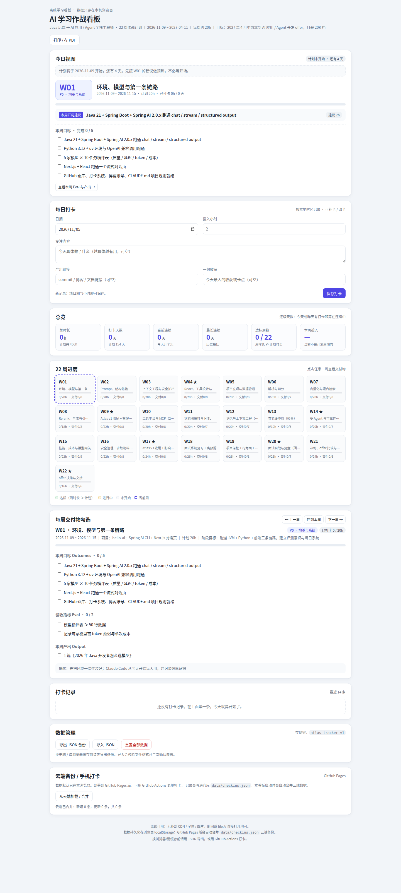

# Java 后端 → AI 应用 / Agent 全栈 · 22 周作战包

> **目标**：2027 年 4 月中前拿到 **AI 应用开发 / Agent 开发** offer，月薪 **20K 档**，具备后端 + 前端全栈交付能力。
> **窗口**：2026-11-09 → 2027-04-11（22 周）｜**投入**：20h/周（工作日 2h + 周末 10h）｜**总预算**：约 456h
> **定位**：不做算法研究，不丢 Java 去当 Python 新人；做**能把大模型能力在企业系统里落地、可观测、算得清成本、有完整前端**的工程师。
> **在线版**：<https://shaoxiaofeng03.github.io/AI-FS/> ｜ **打卡看板**：<https://shaoxiaofeng03.github.io/AI-FS/tracker/>

---

## 0. 30 秒总览

```
P0 地基        P1 应用核心     P2 RAG          P3 Agent        P4 生产化       P5 求职
W1–W2          W3–W5          W6–W9           W10–W14         W15–W17         W18–W22
环境/模型      Prompt/工具     Atlas v1        Atlas v2        性能/成本/安全   面试/offer
打卡系统       评测集/立项     全栈+评估       MCP/状态图/记忆  投递启动         谈判/交接
   │              │              │               │               │               │
 11/22          12/13          01/10           02/14           03/07           04/11
```

**一个旗舰项目，三次演进**：RAG 知识库 → Agent 工作台 → 生产化平台（Atlas）。
**三条腿**：AI 应用 + Agent（55%）· Java 生产化（15%）· 前端（15%）· 求职表达（15%）。

---

## 1. 现在立刻做的 5 件事（48 小时内）

1. **建仓库 + 配 AI 编程环境**：`atlas`（项目）+ `ai-notes`（笔记/博客）；装 Claude Code/Codex，写第一版 `CLAUDE.md`。
2. **跑通一条链路**：Java 21 + Spring Boot + Spring AI 2.0.x 调通一次流式对话，截图存档。
3. **生成 W1 打卡**：`python3 scripts/gen_checkin.py --week 1`，打开 `tracker/index.html` 完成第一次打卡。
4. **填能力基线**：用 [每日打卡与精进系统](docs/03-每日打卡与精进系统.md) 的 6 维表给自己打分，记下日期。
5. **发一条公开承诺**：在掘金/知乎/朋友圈发「22 周从 Java 后端转 AI 应用开发，每周复盘」，链接贴进 W1。

> 做完这 5 件，你已经超过 90% 只收藏不行动的人。

### 如果你已经学过一部分（旧版 W1–W2）

旧资料（`ai-learning-notes`）里的 Python 基础、大模型概念、demo1 参数实验可以复用，但**不要重复看课**。用下面的方式接入：

1. 用 W1/W2 的验收标准自测：能否用 Spring AI 2.0.x 跑通 chat/stream/JSON？能否手写 tool loop？能否做出 30 条评测集？
2. 能过 → 在 `checkin/W01`、`W02` 文件顶部注明「已校准」，从 W3 开始；省下的 2 周补「模型横评 + CLAUDE.md + 评测集」。
3. 不能过 → 只补缺口，不重学全部；W1 的环境/模型横评仍然要做（它是后面所有对比的基线）。
4. 旧版的 Python 练习可以当「卡片复习材料」，不要占主线时间。

---

## 2. 文档地图

| 文档 | 回答什么问题 | 什么时候看 |
|---|---|---|
| [00 · 目标与策略](docs/00-目标与策略.md) | 为什么去、20K 意味着什么、技术选型、风险与降级 | 开始前 / 迷茫时 / 每月回炉 |
| [01 · 学习路线图](docs/01-学习路线图.md) | 22 周总表、6 个阶段、里程碑、验收标准 | 每周规划 |
| [02 · 每周执行手册](docs/02-每周执行手册.md) | 这周周一到周日具体做什么 | **每天** |
| [03 · 每日打卡与精进系统](docs/03-每日打卡与精进系统.md) | 怎么坚持、怎么复盘、怎么精进、防断更 | **每天/每周** |
| [04 · 旗舰项目 Atlas](docs/04-旗舰项目Atlas.md) | 项目怎么设计、怎么评估、怎么写简历、怎么讲 | 做项目 / 面试前 |
| [05 · 面试与求职作战](docs/05-面试与求职作战.md) | 简历、题库、系统设计、手撕、投递、谈判 | W15 之后 |
| [06 · 专家方法与工具](docs/06-专家方法与工具.md) | 像专家一样用资料/工具/AI，附提示词 | 全程 |
| [07 · 文档生成方法](docs/07-文档生成方法.md) | 这份计划怎么来的、怎么改、可复用提示词 | 想调整计划时 |
| [08 · 资源清单](docs/08-资源清单.md) | 按阶段看什么、不看什么 | 找资料时 |
| [09 · 在线打卡与看板](docs/09-在线工具.md) | GitHub Pages 上怎么打卡、数据存哪、手机怎么用 | 部署后 |
| [GitHub Pages 部署](GITHUB_PAGES.md) | 建仓库、开 Pages、Actions 打卡、自定义域名 | 上线时 |
| [市场与技术调研](research/2026-市场与技术调研.md) | 2026-11 岗位 JD、版本、价格、面试考察、来源 | 核实 / 更新认知 |

**配套工具**

| 文件 | 用途 |
|---|---|
| [plan/plan.json](plan/plan.json) | 22 周计划唯一数据源（改计划只改这里） |
| [tracker/index.html](tracker/index.html) | 离线打卡看板：今日视图、连续天数、22 周进度、导出/导入 |
| [scripts/gen_checkin.py](scripts/gen_checkin.py) | 生成每周打卡 Markdown |
| [scripts/build_tracker.py](scripts/build_tracker.py) | 由 plan 重建看板 |
| [scripts/plan_to_csv.py](scripts/plan_to_csv.py) | 导出 Excel/飞书可用的 CSV |
| [checkin/](checkin/) | 已生成的 W01–W22 周打卡文件 |
| [DECISIONS.md](DECISIONS.md) | 技术决策日志：每周至少 1 条，面试「为什么」的答案 |
| [ERRORS.md](ERRORS.md) | 错题/踩坑本：每周整理，避免重复犯错 |
| [data/checkins.json](data/checkins.json) | 云端打卡数据（Actions / 手动提交；看板自动合并） |
| [GitHub Actions 工作流](GITHUB_PAGES.md) | 部署 Pages / Actions 打卡 / 校验 三个 workflow |

---

## 3. 工具快速开始

```bash
# 1) 生成 W1 打卡（默认不覆盖已有文件）
python3 scripts/gen_checkin.py --week 1

# 2) 打开离线看板（双击也可以；file:// 下部分浏览器禁用 localStorage，建议起本地服务）
python3 -m http.server 8765
# 浏览器打开 http://127.0.0.1:8765/tracker/index.html

# 3) 重建看板 / 导出 CSV
python3 scripts/build_tracker.py
python3 scripts/plan_to_csv.py

# 4) 全部重新生成（改了 plan.json 或模板后）
python3 scripts/gen_checkin.py --all --force
```

> 看板数据存在浏览器 `localStorage`（键 `atlas-tracker-v1`），换设备前用「导出 JSON」备份。
> 计划改了：只改 `plan/plan.json`，再跑 `--all --force` + `build_tracker.py` + `plan_to_csv.py`。



### 3.1 部署到 GitHub Pages（可选，但推荐）

1. 新建 **public** 仓库，把本目录 push 上去（`main` 分支）。
2. 仓库 **Settings → Pages → Source** 选 **GitHub Actions**。
3. 需要 Actions 打卡的话，**Settings → Actions → General → Workflow permissions** 选 **Read and write**。
4. push 后等待 `Deploy GitHub Pages` 完成，访问 <https://shaoxiaofeng03.github.io/AI-FS/>。
5. 每日打卡：仓库 **Actions → 每日打卡（Cloud Check-in）→ Run workflow**；数据写进 `data/checkins.json`，看板自动合并。

> 完整步骤、base path、自定义域名、常见 404/权限问题：[GITHUB_PAGES.md](GITHUB_PAGES.md)。
> 数据默认存浏览器 localStorage；Actions 打卡是「提交式同步」，不是实时后端。

---

## 4. 每周节奏（标准档 20h）

| 时间 | 时长 | 内容 |
|---|---|---|
| 周一–周五 | 2h × 5 | 20min 输入 → 60min 动手 → 10min 复述 → 10min 卡片 → 20min commit/明日计划 |
| 周六 | 6h | 上午 3h 项目主线；下午 2h 专项/补欠账；晚上 1h 写文章 |
| 周日 | 4h | 上午 2h 验收；下午 1h 模拟面试/回炉；晚上 1h 周复盘 + 下周计划 |

**三条纪律**

1. 每天有 commit（最低限度版也算）。
2. 每周有可运行产出（不是「看完了」）。
3. 每周有对外输出（博客/笔记/视频，500 字也算）。

> 详细到每天的动作见 [02 · 每周执行手册](docs/02-每周执行手册.md)；打卡模板见 [03](docs/03-每日打卡与精进系统.md)。

---

## 5. 四个核心策略（为什么是这套）

| 策略 | 一句话 | 依据 |
|---|---|---|
| **JVM 主线 + Python 副线** | 用 Java 存量优势打企业 AI 落地，Python 够读够改够评测 | 20K 主力雇主是外包/中型软件/传统行业数字化；Java+AI 双栈竞争更小 |
| **一个项目三次演进** | RAG → Agent → 生产化，讲得深比做得多值钱 | 22 周做 3 个深项目不现实；面试要的是取舍与数字 |
| **评测先行** | 没有评测集的项目 = 玩具 | 20K 与 15K 的分水岭是「上线 + 评测 + 工程化」 |
| **求职单独排期** | W16 试水、W17 正式、3 月主投、4 月拿 offer | 金三银四窗口错过要等半年 |

**技术基线（2026-11）**：Spring AI 2.0.x、LangChain4j 1.23、LangGraph4j 1.8.8、MCP 2026-07-28 规范、Next.js 16 + AI SDK 6、pgvector 0.8、Langfuse/RAGAS。详见 [00 §8.5](docs/00-目标与策略.md)。

---

## 6. 成功标准

**结果**

- [ ] 2027 年 4 月中前拿到 offer，月薪 ≥ 20K（一线）/ ≥ 15–18K（二线，按购买力折算）
- [ ] 至少 2 个 offer 可比，或有 1 个保底 offer
- [ ] 岗位方向：AI 应用 / Agent / AI 平台 / Java + AI

**能力**

- [ ] 独立完成 RAG 全链路 + Agent 状态图 + MCP 工具 + HITL + 评测 + 部署
- [ ] 能讲清每个选择的备选、判据、实测数字、代价、改选条件
- [ ] 能扛项目追问 5 层、系统设计 1 小时、手撕 agent loop/限流/LRU
- [ ] 有可访问 demo + 评估报告 + 6–8 篇博客 + 3 分钟视频

**过程（每周）**

- [ ] 5 天有 commit
- [ ] 1 篇对外输出
- [ ] 1 次周复盘
- [ ] 1 次模拟面试（W4 起）
- [ ] 卡片复习 ≥ 5 天

---

## 7. 计划维护

- **每周日**：打开 [03 §4](docs/03-每日打卡与精进系统.md) 做四问复盘；需要调整就改 `plan/plan.json`。
- **每月回炉日**（W4/W8/W12/W16/W20）：能力体检 + 模拟面试 + 作品集更新 + 下月计划。
- **面试反馈优先**：哪一块被问倒，下一周就补哪一块。
- **落后 > 2 周**：按 [00 §9](docs/00-目标与策略.md) 的降级预案砍范围，**不砍投递时间**。

---

## 8. 目录结构

```
AI全栈/
├── README.md                 # 你在这里
├── index.md                  # GitHub Pages 首页（VitePress）
├── GITHUB_PAGES.md           # 部署 + 云端打卡指南
├── docs/                     # 00–09 学习/求职/在线工具文档
├── plan/
│   ├── plan.json             # 22 周计划数据源
│   └── plan.csv              # Excel/飞书版
├── checkin/
│   ├── templates/week.md     # 周打卡模板
│   └── W01..W22-每日打卡.md  # 每周打卡文件
├── tracker/
│   ├── index.html            # 打卡看板（含云端合并）
│   ├── template.html         # 模板
│   └── README.md             # 工具说明
├── data/checkins.json        # 云端打卡数据（Actions 写入）
├── scripts/                  # 生成器/构建器/导出器/云合并/校验
├── research/                 # 2026-11 市场与技术调研（含来源）
├── .github/workflows/        # Pages 部署 / Actions 打卡 / 校验
├── .vitepress/config.mts     # VitePress 配置（base/侧边栏/搜索）
├── public/                   # 构建时生成（tracker/plan/data/checkin 副本）
├── DECISIONS.md              # 技术决策日志（面试弹药库）
├── ERRORS.md                 # 错题与踩坑本
└── assets/                   # 截图/图
```

---

## 9. 来源与说明

- 本计划参考了旧版资料（`/home/sky/Documents/ai-learning-notes`、`/home/sky/Documents/context/EduHub`）的结构与原则，但**重新做了取舍和撰写**，没有照抄。
- 市场、薪资、版本信息来自 2026-11-05 的公开检索与官方文档；详细来源、证据等级、存疑点见 [调研报告](research/2026-市场与技术调研.md)。
- 薪资/岗位数据为**量级参考**，不是承诺；技术版本会变，动手前以官方文档为准。
- 计划按「在职、每周 20h、22 周」设计；如果你的实际投入/基础不同，按 [07 §13](docs/07-文档生成方法.md) 的提示词重排。

---

> **最后一句**：这份计划的价值不在「写得多全」，而在「你明天真的打开 02，做完那 2 小时，提交一个 commit」。
> 先跑起来，再优化。
